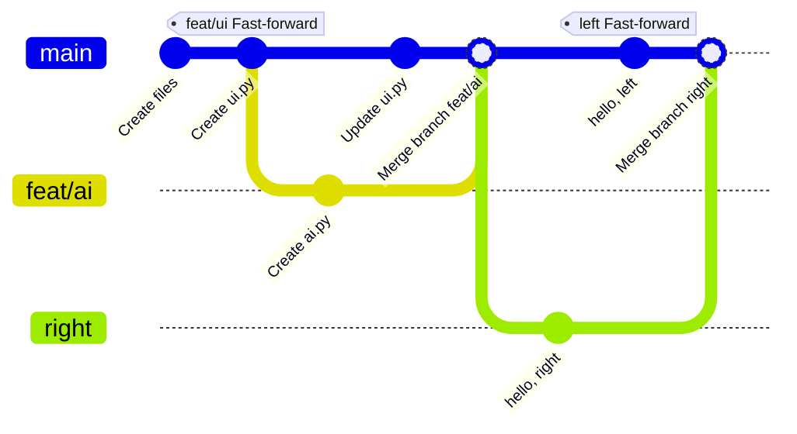

# 20261118 민지수 과제 - Git 병합(Merge)과 충돌(Conflict), GitHub Push

## 1. Git을 사용하는 목적

- **코드 변경 이력을 관리하기 위해서다. (버전 관리, Version Control)**
- 언제, 누가, 무엇을 바꿨는지 기록이 남고, 문제가 생기면 이전 버전으로 되돌릴 수 있다.
- 브랜치로 작업을 나누고 합칠 수 있어 여러 사람이 동시에 협업하기 좋다.

### Q. Commit은 무엇의 단위로 볼 수 있는가?

- **변경 이력(버전)의 단위**다. 커밋 하나가 "그 시점 프로젝트 상태의 기록" 하나다.
- 좋은 습관은 한 커밋 = 한 작업(의미 있는 변경 하나)이다. 예: `Create ui.py`, `Update ui.py`
- 커밋 단위로 기록을 보고, 커밋 단위로 되돌아갈 수 있다.

---

## 2. Merge (병합)란?

- **다른 브랜치의 작업 내용을 현재 브랜치로 합치는 것**
- 합쳐 받을 브랜치로 먼저 이동한 뒤 실행한다.

```bash
git switch main        # 1. 합쳐 받을 브랜치(main)로 이동
git merge feat/ui      # 2. feat/ui의 작업을 main으로 합치기
```

> 실습 중 실수: feat/ui나 right 브랜치에 있는 상태에서 merge를 실행해서 "이미 업데이트 상태입니다"나 엉뚱한 충돌이 났다. **merge 전에 `git branch`로 `* main`인지 확인**한다.

Git이 병합하는 방법은 상황에 따라 두 가지다.

| 방법 | 언제 | 결과 |
| --- | --- | --- |
| Fast-forward Merge (빨리 감기 병합) | main이 갈라진 뒤 아무것도 안 바뀌었을 때 | 새 커밋 없이 main을 앞으로 이동 |
| 3-way Merge | 양쪽 브랜치 모두 새 커밋이 있을 때 | 병합 커밋(Merge Commit)을 새로 만듦 |

---

## 3. Fast-forward Merge (빨리 감기 병합)

**같은 흐름으로 진행된 커밋일 때, main이 브랜치를 한 번에 따라잡는 것**

```
병합 전
main     : A
feat/ui  : A ── B (Create ui.py)

git merge feat/ui  →  Fast-forward

병합 후
main     : A ── B   ← main이 B로 "빨리 감기"만 함
feat/ui  : A ── B
```

- main 입장에서 feat/ui는 "내 뒤에 커밋이 이어 붙은 것"일 뿐이라 합칠 게 없다.
- 그래서 **새 커밋을 만들지 않고** main이 가리키는 위치만 앞으로 옮긴다.
- 터미널에 `Fast-forward`라고 표시되고, vim 편집기도 열리지 않는다.

```
업데이트 중 c74543f..cd9d992
Fast-forward
 ui.py | 1 +
```

---

## 4. 병합 커밋 (Merge Commit)과 3-way Merge

**Fast-forward가 안 되는 경우, 병합 커밋을 하나 만들어서 두 개의 길을 합친다.** 이를 **3-way Merge**라고 한다.

```
병합 전
              ┌── C (Update ui.py)        ← main
A ── B ───────┤
              └── D (Create ai.py)        ← feat/ai

git merge feat/ai  →  3-way Merge

병합 후
              ┌── C ──┐
A ── B ───────┤       ├── M (Merge branch 'feat/ai')   ← main
              └── D ──┘
```

- main(C)과 feat/ai(D)가 **각자 새 커밋을 가지고 갈라져** 있어서 한쪽이 다른 쪽을 따라잡을 수 없다.
- 그래서 둘을 잇는 병합 커밋(M)을 새로 만든다.
- **병합 커밋은 직접 코드를 바꾸지 않고, 두 갈래의 길을 하나로 이어 주기 위한 커밋**이다. 부모 커밋이 2개다. (`git log`의 `Merge: 0a76992 ab93309`)
- 병합 커밋 메시지를 쓰는 vim이 열린다. `esc` → `:wq`로 저장하거나, `git merge feat/ai --no-edit`로 vim 없이 진행할 수 있다.

### 왜 "3-way"인가?

Git은 3개의 지점을 비교해서 합친다.

| 지점 | Git 용어 | 실습 예 |
| --- | --- | --- |
| 공통 조상 (갈라지기 전 지점) | Base / Merge Base | B (Create ui.py) |
| 현재 브랜치의 최신 커밋 | Ours / HEAD | C (Update ui.py) |
| 합치려는 브랜치의 최신 커밋 | Theirs | D (Create ai.py) |

공통 조상과 비교해서 **한쪽만 바꾼 부분은 그 변경을 자동으로 가져오고**, 서로 다른 파일이나 다른 줄을 바꿨다면 둘 다 자동으로 합친다.

---

## 5. Conflict (충돌)

### 5-1. 충돌이란

**두 브랜치가 같은 파일의 같은 줄을 서로 다르게 고쳤을 때 생긴다.** Git은 어느 쪽이 맞는지 스스로 정하지 않고, 사람에게 선택을 맡긴다.

비유하면, 원본 문서를 두 사람이 복사해 가서 **같은 문장을 각자 다르게 고쳐 온** 상황이다. 어느 문장을 남길지는 기계가 아니라 사람이 정해야 한다.

### 5-2. 실습 상황

```
                 main: hello.py (원래 내용)
                /                          \
  left 브랜치                               right 브랜치
  print("hello, left")                      print("hello, right")
```

1. **`git merge left`** → main은 그동안 바뀐 게 없으므로 **Fast-forward**로 합쳐진다. main의 hello.py는 `print("hello, left")`가 된다.
2. **`git merge right`** → **충돌!**

| 지점 | hello.py의 그 줄 |
| --- | --- |
| 공통 조상 (Base) | 원래 내용 |
| main (Ours, left를 합친 뒤) | `print("hello, left")` |
| right (Theirs) | `print("hello, right")` |

같은 줄이 양쪽에서 다르게 바뀌어서 Git이 판단할 수 없다. 병합이 멈추고 이런 메시지가 나온다.

```
자동 병합: hello.py
충돌 (내용): hello.py에 병합 충돌
자동 병합이 실패했습니다. 충돌을 바로잡고 결과물을 커밋하십시오.
```

`git status`에서는 `양쪽에서 수정: hello.py` (both modified)로 보인다.

### 5-3. 충돌이 나면 파일은 이렇게 바뀐다

```
<<<<<<< HEAD
print("hello, left")
=======
print("hello, right")
>>>>>>> right
```

| 표시 | 뜻 |
| --- | --- |
| `<<<<<<< HEAD` ~ `=======` | 지금 브랜치(main)의 내용 (Current) |
| `=======` ~ `>>>>>>> right` | 합치려는 브랜치(right)의 내용 (Incoming) |

### 5-4. 해결 방법

1. 파일을 열어 **원하는 최종 모양으로 직접 고치고**, `<<<<<<<`, `=======`, `>>>>>>>` 표시 줄을 모두 지운다.
2. 저장한 뒤 "해결했다"고 Git에 알리고 커밋한다.

```bash
git add hello.py
git commit -m "Merge branch 'right'"
```

VS Code에서는 충돌 부분 위의 버튼으로 고를 수 있다.

| 버튼 | 결과 |
| --- | --- |
| Accept Current Change | main 내용(`hello, left`)만 남김 |
| Accept Incoming Change | right 내용(`hello, right`)만 남김 |
| Accept Both Changes | 두 줄 다 남김 |
| 직접 수정 | 원하는 대로 새로 씀 |

**실습에서는 직접 수정해서 `print("Hello, left & right")`로 해결했다.**

### 5-5. 충돌을 정리하면

- 충돌은 오류가 아니라 **"사람이 결정해 달라"는 Git의 요청**이다.
- **같은 파일의 같은 줄**을 양쪽에서 바꿨을 때만 생긴다. 다른 파일이나 다른 줄이면 자동으로 합쳐진다.
- 해결 순서: **파일 고치기 → 충돌 표시 지우기 → `git add` → `git commit`**
- 병합을 취소하고 싶으면 `git merge --abort`로 병합 전 상태로 돌아간다.

---

## 6. 오늘 실습한 브랜치 구조

### 6-1. 그림으로 보기



### 6-2. `git log --all --oneline --graph` 결과

```
*   4d19a2f (HEAD -> main, origin/main) Merge branch 'right'   ⑥ 충돌 해결 후 3-way Merge
|\
| * 0d41648 (right) hello, right                              ⑤ right 브랜치 작업
* | 5643b1d (left) hello, left                                ④ left → main Fast-forward
|/
*   e696503 Merge branch 'feat/ai'                            ③ 3-way Merge (병합 커밋)
|\
| * ab93309 Create ai.py                                      ② feat/ai 브랜치 작업
* | 0a76992 Update ui.py                                      ② main에서 ui.py 수정
|/
* cd9d992 Create ui.py                                        ① feat/ui → main Fast-forward
* c74543f Create files                                        첫 커밋
```

그래프 읽는 법 (아래에서 위로):

| 단계 | 한 일 | 병합 방식 |
| --- | --- | --- |
| ① | feat/ui에서 ui.py 생성 후 main에 merge | Fast-forward (main이 그동안 그대로) |
| ② | main은 ui.py 수정, feat/ai는 ai.py 생성 (갈라짐) | — |
| ③ | feat/ai를 main에 merge | 3-way Merge → 병합 커밋 생성 |
| ④ | left(`hello, left`)를 main에 merge | Fast-forward |
| ⑤ | right(`hello, right`)는 같은 줄을 다르게 수정 | — |
| ⑥ | right를 main에 merge → **충돌** → 직접 수정 후 커밋 | 3-way Merge → 병합 커밋 생성 |

- `|\`, `|/` 부분이 브랜치가 갈라지고 합쳐지는 곳이다.
- `HEAD -> main`: 지금 main에서 작업 중이다.
- `origin/main`: GitHub에 push된 main의 위치다.
- feat/ui, feat/ai는 merge한 뒤 삭제해서 이름표가 보이지 않는다. 브랜치를 지워도 커밋 기록은 main 안에 남아 있다.

### 6-3. 최종 파일 내용 (main)

| 파일 | 내용 | 만든 곳 |
| --- | --- | --- |
| `hello.py` | `print("Hello, left & right")` | left·right 충돌 해결 |
| `world.py` | `print("world")` | main |
| `api.py` | `print("API")` | main |
| `ui.py` | `print("UI!!!!!!!!!")` | feat/ui → main에서 수정 |
| `ai.py` | `print("AI")` | feat/ai |

---

## 7. 오픈 소스 (Open Source)

### 7-1. 소스 코드와 오픈 소스

- **소스 코드(Source Code)**: 프로그램을 돌릴 수 있는 원천 코드
- **오픈 소스**: 소스 코드를 **공개해서 누구나 보고, 사용하고, 고치고, 다시 배포할 수 있게 한** 소프트웨어
- 예: Python, Git, Linux, PyTorch

### 7-2. 라이선스 (License)

- 오픈 소스라도 **어떻게 써도 되는지 조건**이 있다. 그 조건을 적은 것이 라이선스다.
- 저장소 주인이 `LICENSE` 파일로 명시한다. 예: MIT(거의 자유롭게 사용 가능), GPL(수정해서 배포하면 그 코드도 공개해야 함), Apache 2.0
- 라이선스는 **코드를 숨기는 기능이 아니라, 사용 조건을 알려주는 약속**이다. Public 저장소의 코드는 누구나 볼 수 있다.
- 라이선스 파일이 없으면 남이 그 코드를 마음대로 가져다 쓸 수 없다. 저작권은 만든 사람에게 있다.
- 코드를 아예 남이 못 보게 하려면 저장소를 **Private**으로 만든다.

### 7-3. 주의: API 키를 Public 저장소에 올린 경우

API 키는 내 계정으로 유료 서비스를 쓸 수 있는 비밀번호와 같다. Public 저장소에 올라가면 누구나 볼 수 있다.

1. **해당 키를 즉시 무력화(삭제)하고 새로 재발급한다.** 가장 중요하다.
2. 저장소에서 파일을 지운다. 단, 파일을 지워도 **커밋 기록에는 남아 있으므로** 1번이 필수다.
3. 예방하기: 키는 `.env` 같은 파일에 따로 두고, 그 파일 이름을 `.gitignore`에 적어 Git이 올리지 않게 한다.

```bash
echo .env >> .gitignore
```

---

## 8. GitHub에 Push하기

**Push**: 내 컴퓨터(로컬 저장소)의 커밋을 GitHub(원격 저장소)에 올리는 것

```
내 컴퓨터 (로컬 저장소)  ──git push──▶  GitHub (원격 저장소)
```

### 8-1. 순서

1. GitHub에서 새 Repository를 만든다. (Public, "Add a README file" 체크 안 함)
2. 원격 저장소 주소를 연결한다.
   ```bash
   git remote add origin https://github.com/jsjs256256-rgb/oz-practice.git
   git remote -v        # 연결된 주소 확인
   ```
3. push한다.
   ```bash
   git push -u origin main
   ```
   - `origin`: 원격 저장소의 별명
   - `main`: 올릴 브랜치
   - `-u`: 이 연결을 기억해서, 다음부터 `git push`만 쳐도 되게 한다.
4. 결과에 `* [new branch] main -> main`(첫 push) 또는 `main -> main`이 보이면 성공이다.

### 8-2. 실습 중 겪은 문제와 해결

| 문제 | 원인 | 해결 |
| --- | --- | --- |
| `error: origin 리모트가 이미 있습니다` | `git remote add origin https:`처럼 잘못된 주소로 먼저 등록됨 | `git remote set-url origin 올바른주소`로 주소만 바꿈 |
| `403` / `Permission denied` | 맥에 다른 GitHub 계정 로그인 정보가 저장됨 | 저장된 정보를 지우고 `gh auth login`으로 본인 계정 로그인 |
| GitHub에 파일이 빈 채로 보임 | 코드를 저장만 하고 add·commit을 안 함 | `git status` 확인 → add → commit → push |

---

## 9. 오늘 배운 명령어 정리

| 명령어 | 하는 일 |
| --- | --- |
| `git switch main` | main 브랜치로 이동 |
| `git merge 브랜치` | 해당 브랜치를 현재 브랜치에 합치기 |
| `git merge 브랜치 --no-edit` | vim 없이 기본 메시지로 병합 커밋 |
| `git merge --abort` | 진행 중인 병합 취소 |
| `git branch -d 브랜치` | 다 쓴 브랜치 삭제 |
| `git log --all --oneline --graph` | 모든 브랜치 구조를 그림으로 보기 (`q`로 나가기) |
| `git remote add origin 주소` | 원격 저장소 연결 |
| `git remote set-url origin 주소` | 원격 저장소 주소 변경 |
| `git push -u origin main` | GitHub에 올리고 연결 기억 |

## 10. 다음 학습

- `git pull`: GitHub의 변경 내용을 내 컴퓨터로 가져오기
- Issues: GitHub에서 할 일, 버그, 아이디어를 기록하고 관리하는 기능
